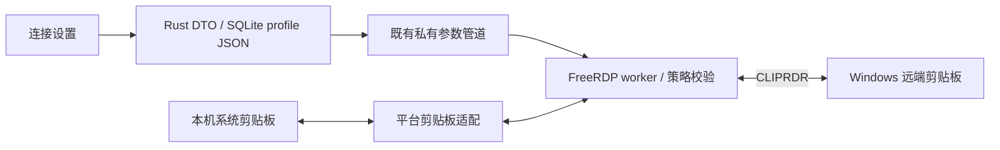

# RDP 双向剪贴板调研与实施方案

> 当前行为契约：[rdp-clipboard](../../openspec/specs/rdp-clipboard/spec.md)。本文用于使用或实现说明，不另行扩展行为承诺。

> 迁入的说明与实现记录；行为要求以关联 OpenSpec 主规格为准。
> [迁移记录（2026-11-21）](../history/documentation-migration-map-2026-11-21.md)；保留原文时间与验收限定语。

状态：配置、文本与文件的原生接入已实现，真实 Windows Server 双端传输仍待验收。

## 实施结果

- 新增逐连接 `clipboardMode` 三档设置，Rust 默认关闭、未知值拒绝；profile JSON 兼容旧数据，重启后保留选择。前端仍只传递设置。
- 引擎升级并固定到 FreeRDP 3.33.0，校验下载 SHA-256；构建目录包含版本号，避免复用旧版本 CMake 缓存。现有认证 / 证书 / 原生窗口适配锚点继续严格校验。
- macOS 使用上游 SDL3 与无 FUSE 的 Finder 文件桥。Windows 从同版上游 `wf_cliprdr.c` 生成独立适配，移除 Windows GUI 客户端上下文依赖，复用其 OLE 延迟文件读取和原生文本剪贴板。
- 双方格式列表和本机数据请求采用共同白名单：纯文本模式只允许 Unicode / 兼容文本；文件模式额外允许文件描述符与文件内容。HTML、图片和未知格式不开放。文本模式的文件能力位及 FileContents 回调也被禁用 / 显式拒绝，不只依赖参数。
- Windows 单次文件内容请求上限 4 MiB，数据等待改为 15 秒；断开时唤醒等待并关闭原生剪贴板窗口。文件传输仍由原生实现分块取数，不映射驱动器。
- 本机剪贴板发布限制为前台 worker。Windows 原生线程在前台切入时重新发布当前本机格式；macOS 在 SDL 焦点进入时刷新本机格式。后台远端格式不直接写入本机系统剪贴板。
- 新增原生白名单 / 拒绝文件请求测试；Rust 覆盖三档参数、关闭驱动器、旧数据默认、未知枚举拒绝与 SQLite 重启回读。认证、证书和 worker 生命周期另做回归。

验证边界：Windows 适配做 Windows 目标交叉编译检查，尚非 MSVC 全安装包验证；自动策略测试不等于真实 Explorer / Finder 与 Windows Server 的双向粘贴验收。多会话切换、文件中途改剪贴板、目录、超大文件和慢链路取消仍需实机验收。本文下方保留原始调研依据及验收清单，不能把所有建议都视为已经完成。

## 2. 已确认的现状

实施前的 3.32.2 观察已移至 [历史调研](../history/rdp-clipboard-research.md)，不再作为当前能力说明。

## 3. 接入现有架构

文本和文件内容由原生 worker 处理，不经 React、Tauri invoke、日志或配置数据库中转。继续保留独立原生桌面和现有 TLS / NLA、证书设置。

### 数据与参数

- Rust / TypeScript 同时新增 `clipboardMode: "off" | "text" | "textAndFiles"`。
- Rust enum 使用 `serde(default)`，默认 `off`；未知值拒绝，不能回退为全开放。
- 当前 SQLite 的 `rdp_profiles.profile_json` 已存完整 profile JSON，因此新增字段可通过兼容反序列化落地，无需增加 SQL 列或破坏旧库。
- `rdpService.saveRdpProfile` 显式解构 DTO，必须把新字段加入保存请求；新建默认值、编辑回填、复制配置等路径一起检查。
- `off` 不启用 CLIPRDR。其他模式启用通道并由 worker 在协商、格式列表、数据请求和响应四个入口落实模式。
- “仅文本”只允许 `CF_UNICODETEXT` 及必要的兼容文本转换，过滤 HTML、图片、文件描述符和文件流；不能只隐藏文件列表而仍响应文件内容请求。
- 文件模式使用 CLIPRDR 的 FileGroupDescriptorW / FileContents 流式请求，保留 `-drives`，不自动暴露本机磁盘。服务端策略禁止文件剪贴板时应提示受限，不尝试绕过。

### 平台实现

**Windows：** 以固定版本的 `wf_cliprdr.c` 为参考，把 OLE / IDataObject、格式协商与流读取的必要逻辑适配到独立的 SDL3 剪贴板上下文；处理 COM 线程归属、Explorer 的 `CF_HDROP`、远端虚拟文件的延迟读取以及取消。不能让 Windows 原生桥和 SDL 通用桥同时抢占同一通道的回调。

**macOS：** 优先评估上游 3.33.0 的 Finder 文件复制实现。上游发布说明明确新增无需 FUSE 的 macOS 文件剪贴板，相关入口包括 `WITH_CLIPRDR_FILE_APPLE` 和 `cliprdr_file_context_set_local_clipboard_data`。优先复用其文件承诺 / 系统剪贴板桥接；不要求用户安装 macFUSE。

3.33.0 于 2026-11-02 发布，包含大量其他引擎变化。建议先在隔离构建中评估升级并验证所有现有源码适配锚点；如果暂不升级，需连同必要依赖完整回移相关补丁，不能只复制一个源文件。本文不直接升级生产引擎，也不承诺升级后 Windows SDL3 文件复制自动可用。

### 生命周期与文件处理

- 多 RDP 会话共享本机系统剪贴板：只有前台会话发布新的本机剪贴板内容；已开始的文件读取固定到原会话和剪贴板代次，避免切窗后串线。
- 去重自身发布的剪贴板变更，避免本机与远端循环同步；本机有新复制内容时，不用旧的远端响应覆盖它。
- 文件按需、分块读取，不能把整个文件一次载入内存。限制并发、待处理请求、文件数量及临时缓存总量；具体限制在平台原型测试后确定。
- 接收端粘贴目标由 Explorer / Finder 或目标应用决定。校验远端文件名、相对路径和长度，拒绝绝对路径、`..` 和路径越界；不执行接收文件。
- 关闭或网络断开时取消请求、释放回调 / COM 对象并清理未完成缓存；应用锁保留连接，但阻止新的剪贴板取数和文件请求，进行中的复制可能取消，解锁后可重新复制。不无条件清空用户后来复制的本机剪贴板。已交付给系统粘贴操作的临时文件需按所有权和使用期回收。
- 剪贴板通道失败优先呈现为会话内的传输错误，不自动把仍可用的桌面会话标记为连接失败；真正的 worker 退出继续使用已有退出分类。

## 5. 上游与协议参考

- [当前固定版 SDL3 剪贴板](https://github.com/FreeRDP/FreeRDP/blob/3.32.2/client/SDL/SDL3/sdl_clip.cpp)
- [当前固定版通用文件剪贴板](https://github.com/FreeRDP/FreeRDP/blob/3.32.2/client/common/client_cliprdr_file.c)
- [Windows 原生剪贴板参考](https://github.com/FreeRDP/FreeRDP/blob/3.32.2/client/Windows/wf_cliprdr.c)
- [3.33.0 发布说明](https://github.com/FreeRDP/FreeRDP/releases/tag/3.33.0)
- [3.33.0 SDL3 剪贴板](https://github.com/FreeRDP/FreeRDP/blob/3.33.0/client/SDL/SDL3/sdl_clip.cpp)
- [上游 macOS Finder 文件复制 PR #13591](https://github.com/FreeRDP/FreeRDP/pull/13591)
- [Microsoft：剪贴板重定向及服务端策略](https://learn.microsoft.com/en-us/azure/virtual-desktop/redirection-configure-clipboard)

下文的原始升级建议保留当时语境，升级已在“实施结果”完成；真实 Server/Finder/Explorer 验收状态见 [验证记录](../verification/rdp-clipboard.md)。
