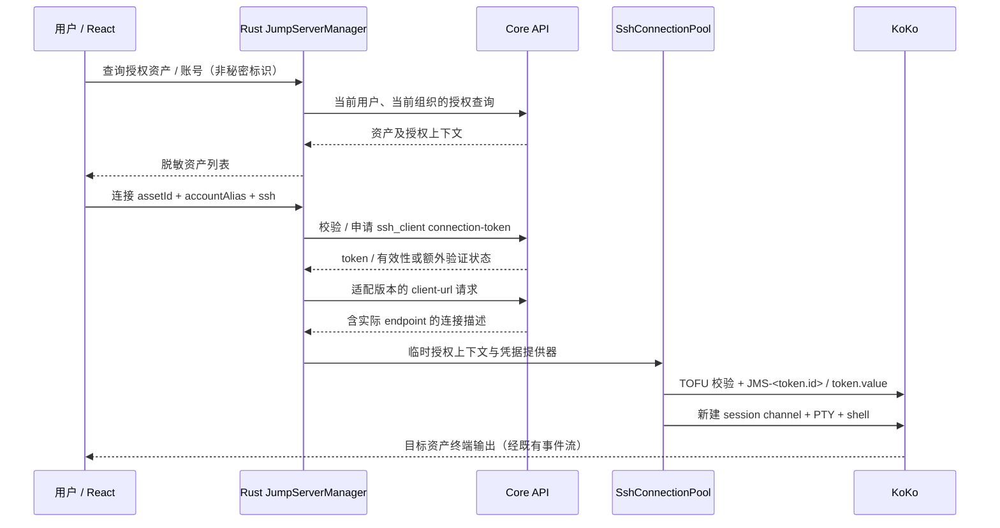

# JumpServer 图形化资产工作台设计

> 状态：首版已接入，待真实部署与原生跨平台验收；实施范围见第 10 节，其余章节保留目标设计。调研 / 实施日期：2026-11-01。
> 目标：在 Duo SSH 中登录 JumpServer 后，以资产树和表格查找服务器，点击选择账号并打开目标终端，免去 TUI 选服步骤。
> 依据：本仓库现状及 JumpServer 官方 GitHub 源码。以 Core / KoKo `v4.10.18` 为主要源码观察基线；`dev` 仅作产品方向参考。未连接用户真实环境，不代表已通过该版本互操作验收。

## 1. 可行性结论

**可以做。推荐采用“Core API 获取当前用户授权资产 + 临时连接令牌 + KoKo SSH PTY”的方式。** GUI 替代的是查找资产、选择账号和发起连接；连接后的命令行仍由现有 xterm 终端承载，流量继续经过堡垒机。

需要先区分用户拥有的入口：

| 环境条件 | 可提供的体验 | 限制 |
| --- | --- | --- |
| Core HTTPS 可达，允许当前用户调用授权资产及连接令牌 API，KoKo SSH 可达 | 完整资产树 / 搜索 / 账号选择 / 点击连接；推荐路径 | API 登录与 SSH 登录是两个认证上下文 |
| 只有 KoKo SSH，允许组合用户名定向连接 | 已知资产收藏列表，点击连接 | 无法据此枚举全部授权资产；每次新连接可能需要 MFA |
| 只有 KoKo SSH，且只能交互菜单选服 | 保留原终端；后续可对已适配的文本菜单提供辅助选择 | 不能承诺通用资产目录；全屏 TUI 不能按普通文本表格处理 |
| 只有 Web 登录，原生 SSH 入口被禁用 | 打开官方 Web 资产页面完成操作 | 首版不自建 WebSocket 终端，不假装原生连接已可用 |

这里的“所有服务器”应明确为**当前用户在当前组织下获授权、且当前查询条件可见的资产**，不是管理员的全量资产库，也不等于资产当前在线。

**仅仅成功 SSH 登录 JumpServer，不能保证客户端自动获得完整资产清单。** SSH 协议没有标准的 JumpServer 资产发现接口，现有 SSH 会话也不自动产生可用于 Core 的 API 凭据。首次升级体验需配置 Core 地址与获允许的 API 认证方式；之后可做到一次进入资产工作台、连续点击连接。

## 2. GitHub 调研依据

以下是上游已观察到的事实；后续章节是 Duo SSH 的设计建议，不能视为上游兼容承诺。

| 官方来源 | 核查结果 | 设计影响 |
| --- | --- | --- |
| [JumpServer Client README](https://github.com/jumpserver/client) | 官方 Tauri 客户端描述了资产浏览、搜索、收藏和点击连接 | 图形化选服有现成产品先例；无需从菜单截图反推目录 |
| [Core 授权资产路由，v4.10.18](https://github.com/jumpserver/jumpserver/blob/v4.10.18/apps/perms/urls/user_permission.py) | 用户路径支持 `my` / `self`；包含资产列表、详情、节点树与按节点查询 | 从用户授权接口构造目录；不要调用管理资产接口替代 |
| [Core 认证路由，v4.10.18](https://github.com/jumpserver/jumpserver/blob/v4.10.18/apps/authentication/urls/api_urls.py) | 注册了 connection-token、认证及 MFA 相关入口 | 能力应分开探测，不能把登录成功等同于全部可用 |
| [连接令牌序列化，v4.10.18](https://github.com/jumpserver/jumpserver/blob/v4.10.18/apps/authentication/serializers/connection_token.py) | 包含 asset、account、protocol、connect_method、actions 及有效性信息 | 连接必须绑定资产与授权账号；前端只收脱敏结果 |
| [连接令牌 API，v4.10.18](https://github.com/jumpserver/jumpserver/blob/v4.10.18/apps/authentication/api/connection_token.py) | `client-url` 生成含 endpoint 和 token 的 `jms://` 数据；创建有权限 / ACL 检查，并可能得到未激活令牌 | Rust 内解析实际端点；审批或额外验证未完成时禁止连接 |
| [连接方法定义，v4.10.18](https://github.com/jumpserver/jumpserver/blob/v4.10.18/apps/terminal/connect_methods.py) | 区分 `ssh_client`、`sftp_client`、`web_cli` 等，且有组件、协议及用户 ACL 过滤 | 不写死所有用户都可使用原生 SSH，也不混用连接方法 |
| [KoKo 认证，v4.10.18](https://github.com/jumpserver/koko/blob/v4.10.18/pkg/auth/ssh.go) | `JMS-` 前缀用于令牌登录，剩余部分查询 token；密码与 token value 比较；也解析组合用户名 | 可用临时令牌进行 SSH 认证；无需拿到资产真实密码 |
| [KoKo SSH 会话处理，v4.10.18](https://github.com/jumpserver/koko/blob/v4.10.18/pkg/handler/server_ssh.go) | PTY shell、SFTP 和非交互请求分支不同；转发受配置约束 | 首版只承诺验证过的 PTY，其他功能单独开放 |
| [KoKo 定向连接，v4.10.18](https://github.com/jumpserver/koko/blob/v4.10.18/pkg/handler/direct_handler.go) | 定向请求处理资产及账号选择，也有 token 模式和 SFTP 上下文 | 不把不同资产共用一个普通网关 transport 当成天然正确 |
| [令牌模型，v4.10.18](https://github.com/jumpserver/jumpserver/blob/v4.10.18/apps/authentication/models/connection_token.py) | 一次性过期由服务端设置，复用受配置控制 | 不硬编码有效期；重连重新授权，不持久化临时密码 |

官方当前开发分支会变化。实现时需记录被验收部署的 Core / KoKo 完整版本、版本对应提交、认证方式和配置；不能凭 `dev` 源码宣称兼容全部 v3 / v4 / v5。调研只作为接口存在与协议路径的证据，不移植上游服务端实现。

## 3. 方案比较与选择

| 路径 | 优点 | 成本 / 问题 | 决策 |
| --- | --- | --- | --- |
| Core API + KoKo 临时令牌 SSH | 结构化资产和身份；复用 Duo SSH 终端 | 需 API 认证与连接池扩展 | 主方案 |
| Core API + KoKo WebSocket | 可贴近 Web 连接方式 | 新终端协议、Web 会话与代理兼容成本；不复用当前 SSH 路径 | 后续独立评估 |
| 已知资产 + 组合 SSH 用户名 | 无需资产列表 API | 不能自动发现资产，分隔符 / 账号 / MFA 需适配 | 仅 SSH 的兼容方案 |
| 解析 TUI 后显示 GUI | 入口要求低 | 分页、截断、语言、终端宽度、全屏渲染和版本变化都影响正确性 | 不作主方案 |
| 内置浏览器打开官方 Luna | 适合 SSO / 复杂审批的人工处理 | 官方 Web 页面体验，不能自动转为原生终端 | 明确标注的回退入口 |
| 把 KoKo 当普通 ProxyJump | 看似可套用多跳 | 不等价于 JumpServer 的资产授权、代管凭据和审计链路 | 不采用 |

本功能与 [TODO 的 SSH 多跳](../TODO.md#3-ssh-多跳钻入与跳板连接)独立：此处由 KoKo 代表用户连接资产，客户端不对目标机进行第二次 SSH 握手，因此无需先完成通用多跳，也不能以通用隧道替代堡垒机的访问控制。

## 4. 用户流程与页面

### 4.1 配置与登录

连接管理新增「JumpServer」连接类型，创建的是平台配置，不是每台资产一个 SSH profile。

表单包括名称、Core HTTPS 地址、API 认证方式、可选的关联 SSH 网关 profile，以及网络代理设置。Core URL 与 KoKo endpoint 分开显示，不能从 SSH 域名猜出 Web 地址或固定使用 2222 端口。

现支持两种经服务端策略允许的 Core 认证：用户名 / 密码（支持 OTP）和普通用户 Access Key 签名。新建连接默认用户名和密码；旧配置缺少认证类型时仍按 Access Key 读取。密码 / Secret 为只写输入，保存时使用独立系统凭据库命名空间；系统凭据库不可用时可选择本次使用，不回退到 SQLite 明文。OTP 验证码、OTP 密钥和 API Token 不持久化，也不读取外部浏览器或已有 WebView 的 Cookie。

密码流程由 Rust 发起：向 `/api/v1/authentication/auth/` 提交用户名 / 密码；收到官方 OTP challenge 时，保留仅限配置 Core 同源的私有 Cookie 会话，界面只收到本地 challenge ID；向固定的 `/api/v1/authentication/mfa/challenge/` 提交 OTP，成功后以空请求体再次获取 Bearer Token，再读取当前用户身份。MFA 阶段不重复发送密码。保留 Cookie / CSRF、限时 5 分钟、最多 5 次尝试、单次在途提交及窗口归属校验；取消、退出、编辑和关闭所属窗口使旧请求结果失效。服务端返回的任意 challenge URL 不作为访问目标。

Core 与 SSH 可使用不同认证策略。SSO、登录审批或非 OTP 验证暂不接续，交回官方 Web 或原 SSH。平台可关联一个已有 SSH 配置，沿用其密码和 keyboard-interactive OTP，经原连接池打开交互终端；不复制其凭据，也不将 SSH 成功视为 Core API 登录。图形化资产目录仍需要可访问且允许该账号认证的 Core HTTPS 服务。

登录后显示当前平台身份、组织和能力检查结果：资产读取、原生 SSH 方法、KoKo 可达性分别有状态。API 可用但 SSH 不可达时，仍可浏览并明确禁用连接。

对已有 SSH JumpServer 配置提供「打开资产工作台」动作。首次引导补充 Core/API 配置；取消后保留已有终端，不静默复用 SSH 密码去尝试 Web 登录。

### 4.2 资产工作台

在连接管理中选择某个 JumpServer 平台，主列进入其资产工作台，通过返回按钮回到连接库；首版不增加新的 activity，也不为目录本身增加一种可分离标签。终端继续使用统一标签条。

```text
┌──────────────────────────────────────────────────────────────────┐
│ ← 连接管理 / 生产 JumpServer     用户 alice · 组织 A      [退出登录] │
├──────────────────────────────────────────────────────────────────┤
│ [搜索资产名称 / 地址________]  协议 SSH ▾   [刷新]  最近同步 10:32  │
├─────────────────┬────────────────────────────────────────────────┤
│ ☆ 收藏           │ 名称           地址          协议   当前会话   │
│ 最近使用         │ app-prod-01    10.20.1.11    SSH    2          │
│ ▾ 授权资产       │ app-prod-02    10.20.1.12    SSH    —          │
│   ▾ 生产         │ db-prod-01     10.20.2.10    SSH    —          │
│     应用         │                                                │
│     数据库       │ 选中：app-prod-01                              │
│   ▸ 测试         │ 账号 [deploy ▾]                   [连接终端]   │
├─────────────────┴────────────────────────────────────────────────┤
│ 已加载 50 / 236 项 · 当前用户授权范围 · 连接经 KoKo                 │
└──────────────────────────────────────────────────────────────────┘
```

这是交互线框，具体尺寸、颜色、排版沿用 Graphite Glass 和现有 UI 组件；表格与目录不加模糊材质。

- 节点树懒加载，表格服务端分页、搜索与协议过滤；请求取消及序号校验阻止旧响应覆盖新查询。无总数时只显示已加载数量，不假造全量。
- 单击选中行；双击或 Enter 发起连接。只有一个授权账号可直接使用；多个账号时打开紧凑选择框，不默认选 root。切换资产后清除旧账号。
- 账号使用服务端授权别名 / 标识作为连接参数，显示名称只用于 UI；无账号、禁用协议及权限不足均展示原因。
- 收藏与最近使用按平台、用户、组织、资产 ID 隔离；收藏只是快捷引用，点击时仍重新校验权限。不复制目标密码，不生成几百条普通 SSH profile。
- 表格里的“当前会话”是本客户端会话数；不把历史连接、目录缓存或 API 中的资产存在误显示为在线。
- 显示加载、空授权、搜索无结果、目录失败、认证过期和部分加载状态。失败后可保留旧行但标记过期，连接必须重新确认权限。
- 搜索框可用快捷键聚焦，表格方向键移动，Enter 连接，Esc 关闭账号弹层；所有图标按钮有标签，窄窗口把节点树折叠为可打开的目录面板。

### 4.3 连接后的工作区

点击后立即创建“正在连接”的终端标签：`app-prod-01 · deploy`，提示中显示平台、组织、资产、账号和 KoKo 端点。认证 / 审批需要交互时显示对应状态，不能将 API 201 或 SSH 认证完成当成已进入目标 shell。

活动会话树按 `平台 / 用户 / 组织 / 资产 / 账号` 标识聚合。资产节点下保留新建终端、终端列表和断开；SFTP、主机工具和端口转发按能力显示，首版未验证的能力禁用并说明原因。

新建终端和分屏继承完整资产上下文，重新获取授权，不返回 KoKo 菜单、不继承别的资产，也不切到本地 shell。拆窗搬移原 session ID 与 pane 树，不重新签发令牌。关闭单个终端只释放它的资源；关闭资产节点按现有运行命令确认规则关闭所属会话。

## 5. 连接协议与状态



上图是待实机验证的主路径。基线候选请求如下，路径、响应包裹、分页、组织 header 与账号字段均由版本适配器处理；没有核实的接口不在 UI 写成已支持：

| 操作 | 候选 API / 来源 |
| --- | --- |
| 当前用户授权资产 | `GET /api/v1/perms/users/my/assets/` |
| 节点与节点下资产 | `GET /api/v1/perms/users/my/nodes/`、`.../nodes/{nodeId}/assets/` |
| 资产详情与授权账号 | `GET /api/v1/perms/users/my/assets/{assetId}/`；P0 核实授权账号所在字段及是否需要补充接口 |
| 申请 SSH 令牌 | `POST /api/v1/authentication/connection-token/`，候选字段为 `asset`、`account`、`protocol: ssh`、`connect_method: ssh_client` |
| 原生连接描述 | `/api/v1/authentication/connection-token/{id}/client-url/`；在 Rust 内解析，不交给系统 URL handler |

状态拆为三个维度，避免“已连接”含义混乱：

- 平台：`signedOut → authenticating → ready / authExpired / unsupported`。
- 单次连接：`resolving → awaitingApproval / awaitingChallenge / connecting → channelOpen / failed / cancelled`。
- 终端交互上下文：`unknown / gatewayMenu / authentication / targetShell / exited`。资产授权绑定不代表 shell 当前状态；只有确认处于目标 shell，才可开放后续采集或命令功能。

审批、人工输入账号、MFA、人脸或其他验证超出首版能力时，返回明确的“需在官方 Web 完成”状态。不得让未激活 token 继续连接，不通过更换 connect_method、管理员接口或反复重试绕过限制。浏览器处理完成后由用户回到应用重试，客户端不猜审批已经通过。

## 6. 与当前架构的衔接

### 6.1 连接池与凭据

当前 `ssh/connection_pool.rs` 的 `ConnectionKey::from_profile` 由普通 SSH profile 生成，持有 profile 身份、版本、host、username、认证种类和代理；现有 acquire 输入也是 `SshProfile`。因此这里**需要扩展连接来源模型，不能只在页面里拼一个用户名就结束**。

建议引入内部 `ConnectionSource::{SavedSsh, JumpServerGrant}` 与 Rust 凭据提供器。保留普通 profile 兼容路径，所有 SSH transport 仍由同一个 `SshConnectionPool` 建立并持有共享 `HostKeyVerifier`；禁止在新 manager 中直接调用独立 SSH 客户端。

JumpServer key 至少隔离平台配置版本、API 用户、组织、资产 ID、授权账号、协议、连接方法、endpoint、代理路由及**本次授权代次**。使用客户端生成的非秘密 grant ID 标识代次，不把 token value 放进 key、Debug、事件或诊断。

首版每次显式新建终端申请一次独立 grant；不同终端不默认共享一次性 token transport。池内仍管理通道所有权、关闭和重连，后续只有在真实服务端证明授权 / 消费 / 审计语义成立后，才评估同一 grant 多 channel。不能为了减少握手开启服务端 token 复用。

令牌只在 Rust 内存中短暂持有。`client-url` 的 Base64 是编码，不是加密；整个 URL 也不得写日志、复制到剪贴板、返回前端或持久化。UI 仅接收 session ID、可展示身份、状态与归一化错误。用户首次输入凭据如需经过表单，应作为只写请求，绝不作为任何响应字段返回。

### 6.2 安全边界

- Core 使用 HTTPS 并校验证书；私有 CA 支持作为明确配置，不提供默认跳过验证。API 请求只向已配置 origin 发送认证；拒绝携带认证跨 origin 重定向，分页 URL 也要验证 origin。
- endpoint 必须从已认证的 Core 描述获得并校验 host / port。新网关或端点变化在 TOFU 提示中显示所属平台；凭据只能在其 SSH 主机密钥验证通过后发送。
- 客户端校验的是 KoKo 的 SSH 主机密钥。KoKo 到目标资产的身份校验由服务端负责，界面不得宣称 Duo SSH 已直接验证目标机指纹。普通多跳的“双层 TOFU”不能照搬到此路径。
- 服务端权限与审计保留在 Core / KoKo；客户端不读取资产真实密码，不使用超级令牌或管理账号枚举，不直连资产 IP。发行前实查会话录像、命令过滤和身份记录，不能只凭连接成功宣布审计完整。
- 错误使用 `AppError` 及前端 service 归一化；禁止直接展示 HTTP body / 认证 header / `jms://`。允许的错误码包括 `jumpserver_auth_expired`、`jumpserver_permission_denied`、`jumpserver_approval_required`、`jumpserver_method_unavailable`、`jumpserver_endpoint_unreachable`。
- 所有 invoke 校验窗口归属、平台身份与组织；列表不能决定最终连接授权。AI 发起远程命令继续走显式确认，不因 GUI 选好资产而自动获准。

### 6.3 重连、退出与多窗口

断线可以沿用现有 30 秒恢复预算，但 JumpServer grant 的恢复必须重新检查 API 身份与权限、重新签发 token 并替换授权代次；不能拿已消费 token 重试。新端点仍须 TOFU 校验。需要 MFA / 审批时停止自动尝试并等待用户；正常 `exit` 不重连，未发送命令不自动重放。

关闭目录页面不关闭终端。平台“退出登录”是显式的全窗口平台操作：清理其 API 会话 / 内存凭据 / 缓存并关闭该身份的活动会话；存在运行命令时复用确认流程。删除已保存 Secret 单独提供操作，不能把本地清除误称为服务端撤销 Access Key。仅断开某资产不注销平台。

新终端的 grant 由进程级 manager 分配并绑定窗口，拆窗只转移所有权。关闭窗口只结束其拥有的终端；其他窗口的目录和终端保留，平台显式退出除外。异步完成的连接若其窗口已关闭必须立即回收。

### 6.4 其他能力分开验收

| 能力 | 首版策略 | 后续开放条件 |
| --- | --- | --- |
| 交互 SSH 终端 | 核心范围 | 真实 PTY、MFA / 拒绝、审计和重连验证 |
| SFTP | 默认不开放 | 独立 `sftp_client` grant、正确资产 / 账号 / 根路径及上传下载权限验证 |
| 主机工具 / AI exec | 对新来源禁用独立 exec | 逐版本验证执行路径、命令过滤、复核与审计；不能继承 PTY 菜单选择 |
| 端口转发 | 默认不开放 | 服务端明确授权与配置、目标边界及审计验收 |
| RDP / 数据库 / Kubernetes | 可标明类型，首版不连接 | 独立设计各协议入口，不能套用已有 RDP 直连能力 |

## 7. 数据与模块设计

以下为拟新增契约，不是当前已存在接口。Rust serde 与 TypeScript DTO 同步使用 camelCase。

| 数据 | 内容 / 存储 |
| --- | --- |
| `JumpServerProfile` | id、name、coreBaseUrl、authKind、secretReference、配置版本、可选关联 SSH profile；SQLite repository + 下一编号迁移；API 返回 DTO 排除秘密，仅暴露 `hasCredential` |
| `JumpServerIdentity` | platformId、userId、orgId、authGeneration；Rust 内存，用于请求、缓存与授权隔离 |
| `JumpServerAsset` | assetId、name、address、nodeIds、protocols；前端脱敏列表，授权账号按需读取 |
| `JumpServerTarget` | platformId、userId、orgId、assetId、accountAlias、protocol、connectMethod；Rust 校验后绑定 session，前端只展示非秘密部分 |
| `JumpServerGrant` | 内部 grantId、token id / value、endpoint、到期信息；仅 Rust 内存，不进入 SQLite / localStorage / 导出 |
| `JumpServerCapabilities` | 目录、原生 SSH、SFTP、exec、转发及不支持原因；按环境探测 / 验收结果，默认关闭未知项 |

首版资产目录只作内存缓存；平台 / 用户 / 组织切换及注销立即清理，请求带 authGeneration 防止旧身份响应回流。收藏持久化为上述身份下的资产引用，不缓存账号秘密；普通连接导出不附带 API Secret、token 或整个资产目录。

建议文件边界：

- `src/jumpserver/`：`JumpServerWorkspace`、`AssetTree`、`AssetTable`、`AccountPicker`、平台状态 hook。
- `src/models/jumpserver.ts`、`src/services/jumpserverService.ts`：脱敏 DTO 与 invoke / 拒绝归一化。
- `src-tauri/src/jumpserver/`：API client、版本适配、身份与 grant 生命周期管理。
- `src-tauri/src/models/jumpserver.rs`、`commands/jumpserver.rs`、`storage/jumpserver_repository.rs`，命令在 `lib.rs` 注册。
- 扩展 `ssh/connection_pool.rs`、`ssh/session_manager.rs`，并把资产上下文接到 `useTerminalSessions`、`SessionTree`、`usePaneLayout` 和 detached workspace；不能只传平台 profile ID。
- `App.tsx` / `SessionManager.tsx` 负责工作台入口；后续 SFTP 接入前，需把 `useWorkspace.ts` 当前仅以 profileId 标识目标的契约扩展为明确连接来源。

拟提供 `jumpserver_login`、`jumpserver_list_assets`、`jumpserver_list_nodes`、`jumpserver_list_accounts`、`jumpserver_open_terminal`、`jumpserver_cancel_connect`、`jumpserver_logout`。列表读取没有远程执行副作用；连接 API 不向前端提供可兑换凭据。连接进度事件绑定 requestId / windowLabel，终端输出继续使用既有事件。

## 8. 分阶段实施与验收门槛

### P0：真实环境协议验证，先于页面开发

在经授权的测试平台完成：确认 Core / KoKo 版本和网络入口；普通用户签名登录；读取本人的分页资产与授权账号；申请原生 SSH token；解析实际 endpoint；由现有连接池完成 `JMS-<id>` 密码认证、PTY 和 shell。使用测试资产验证普通账号与多账号选择，并由管理员核对录像、命令审计与拒绝规则。

同时记录：API / SSH MFA 差异、组织切换方法、token 消费时点及失败后是否可重用、审批 / 禁用方法的响应、真实部署的登录及账号字段。测试材料必须脱敏，不能保存真实 token 或生产资产明细。

**退出条件：至少一个明确版本与配置组合打通，权限拒绝和审计证据成立。否则只交付“可行但待适配”，不开始承诺完整 GUI 支持。**

### P1：最小可用资产工作台

平台配置与安全凭据输入 → 授权目录 / 搜索 / 分页 → 账号选择 → 新建目标终端 → 收藏 / 最近 → 分屏与拆窗继承资产 → 取消、断线、退出与清理。首版只支持 P0 验收过的认证方式和 SSH PTY；不做资产管理、批量执行、后台全库扫描、WebSocket、SFTP 或 exec。

### P2：仅 SSH 的兼容入口

用户手动维护已知资产和账号引用，在服务端支持时使用组合用户名发起定向 PTY。以 `ssh -l '平台用户@资产账号@资产地址' -p <KoKo端口> <KoKo主机>` 表达协议意图；实际由 Rust 组装协议字段，不运行这条本地 shell 命令。特殊分隔符、重复地址及 MFA 需逐环境适配；无法唯一定位时交回原终端，不猜资产编号。

文本菜单辅助只绑定当前实际输出、分页和输入版本，确认在菜单后才发送选择；并发输入或状态变化立即失效。全屏 TUI 与未知版本回退原终端，不盲发 `p` / 数字，避免命令进入目标 shell。页面标明“已知资产”或“本页可见资产”，不标明“全部服务器”。

### P3：逐项增加能力

按真实需求增加交互式登录 / SSO、审批承接、SFTP、受限 exec，以及其他协议；每项独立安全与跨平台验收。任何功能都不以放松服务端策略作为前提。

### 验收清单

- [ ] API 无权限、Key 被撤销、身份过期、MFA / SSO 不支持均有明确状态；不会降级到管理员身份或复用别人的目录。
- [ ] 同名资产、相同 IP 不同组织、相同网关不同账号、多平台相同用户不会串会话；分页和快速搜索不丢项 / 回流旧数据。
- [ ] 多账号必须准确选择授权 alias；权限在展示后撤销时连接被服务端拒绝。
- [ ] KoKo 非默认端口、多 endpoint、NAT / 不可达端点、私有 CA、首次 SSH 信任 / 密钥变化均覆盖。
- [ ] token 过期、连接途中取消、认证失败、窗口关闭和并发点击均回收资源；不重复消费 token 或产生孤儿终端。
- [ ] SSH channel 打开、目标 shell 就绪、退出回菜单分别处理；菜单或认证期间不会发送 AI 命令。
- [ ] 两资产同时连接、重复终端、分屏、新窗口、关闭单个窗口与平台注销都遵循所有权；恢复不重放命令。
- [ ] 日志、DTO、错误、导出、localStorage、诊断和崩溃材料不含 Key Secret、token value、完整 client-url；仅使用合成测试凭据。
- [ ] 管理员实查审计身份、录像与命令过滤；复杂审批不能处理时明确回退。
- [ ] `pnpm tauri dev` 在 macOS / Windows 验证深浅主题、键盘、窄窗口和多窗口。
- [ ] 实施后运行 `pnpm exec tsc --noEmit`、`pnpm build`；Rust 运行 `cargo fmt`、`cargo clippy --all-targets -- -D warnings`、`cargo test`。新增重点回归覆盖 DTO 脱敏、URL / 签名、身份缓存、授权隔离、token 生命周期与迁移兼容。

## 9. 实施前仍需取得的信息

调研已足够确认方案可行，以下信息决定首个适配器及真实可用范围：

1. 用户实际 JumpServer / KoKo 版本、社区 / 企业版本及是否定制。
2. 能否访问 Core HTTPS、是否允许普通用户 Access Key、是否强制 SSO / MFA / 登录复核。
3. KoKo 对外端点、允许的连接方法，以及是否存在多组织、多网关或代理。
4. 经过授权的测试账号和资产，用于核实协议与审计；调研阶段不需要提供生产凭据。

推荐先以“单平台、一个已验证版本、普通用户 API、SSH PTY”完成端到端验证，再制作正式页面。只有 SSH 入口的部署采用已知资产快捷连接，保留原终端作为兼容入口。


## 10. 首版实施情况

已实现一条可使用的原生 SSH 路径：在「新建连接 → 连接类型」选择 JumpServer；保存的平台与 SSH / RDP 一起显示，可按类型筛选、搜索和记录最近使用，也可通过命令面板打开各平台。资产页由所选连接确定平台，头部只显示返回入口和连接名称，不再设置平台选择下拉框或重复的添加按钮。空状态只提供一个新建入口。当前实现与目标设计的边界如下：

| 项目 | 当前实现 |
| --- | --- |
| 平台配置 | 独立 SQLite 表与 `011_jumpserver_profiles.sql` 幂等迁移；新增 / 编辑 / 删除；每个平台固定 Core、认证类型、用户名或 Key ID 和组织，可关联已有 SSH 配置 |
| 认证 | 用户名 / 密码 → OTP → Bearer，或官方 Access Key HMAC-SHA256 签名；后者签入请求目标（含查询）、Accept 和 Date；读取 `/api/v1/users/profile/` 确认真实身份 |
| 凭据 | 密码 / Secret 可保存在独立系统凭据库，OTP 不保存；本次输入仅在内存使用；响应只含 `hasCredential`，不回显密码 / Secret / Cookie / 令牌 |
| 目录 | 授权节点导航、服务端分页与搜索、授权账号按需读取；未知 SSH / 人工凭据账号明确拒绝；节点当前按层级路径列出，尚不可折叠 |
| 组织隔离 | 请求带 `X-JMS-ORG` 与目录 `org_id` 过滤；客户端额外过滤返回项，详情严格核对组织 / 资产 ID，跨组织响应不作为连接依据 |
| 原生连接 | 本地 `jms:` 非秘密 source ID 代表平台登录代次 + 资产 + 账号；保留现有普通 SSH profile 契约，不新增持久化目标 profile；Rust 每次连接重新验证授权并取 grant |
| 连接池 | grant 使用独立配置版本，每次终端新开 transport，仍通过现有池与共享 TOFU 校验；取消中的 grant 有清理 guard，断线不复用已消费 token |
| 终端生命周期 | 新建 / 分屏 / 重复标签继承 source ID；手动及自动重连重新授权；拆窗沿用已有会话；退出平台先使登录失效、关闭全部所属会话，再广播移除标签 |
| 功能门控 | SFTP、文件树、主机工具、exec 和端口转发不随此来源开放；普通手动 JumpServer 终端原路径保持原有能力 |
| 显示方式与 UI 状态 | 与连接管理共用网格 / 列表 / 分组切换控件；记住本机独立偏好；分组按当前页资产所属目录展开 / 折叠，多目录资产在各组展示，未加载目录和缺失元数据明确标注。切换保留资产选择与账号面板；加载、空结果、禁用资产、错误 / 重试、账号选择及确认流程沿用原实现 |

当前尚未实现资产收藏 / 最近使用、可折叠树、显式 HTTP / SOCKS 代理配置、仅 SSH 已知资产快捷入口和 SSO / 审批接续；复杂认证保留原 SSH 终端或由用户使用官方 Web。不会声明这些目标设计已交付。

验证包含 TypeScript 与生产构建、Rust 格式化 / Clippy / 完整测试；新增回归覆盖独立 HMAC 向量、真实回环 HTTP 请求序列化、查询签名、非默认 KoKo 端口、grant 绑定、错误脱敏、组织过滤、登录失效、连接 key 隔离与重复数据库迁移。隔离浏览器用合成资产验证搜索、多账号选择、单账号 Enter 连接、退出确认及深浅主题 / 窄窗口。尚无真实 JumpServer / KoKo 账户验证，不能据此标记为稳定发行；需要重启原生开发进程加载新 Rust 命令，单独 Vite HMR 不足。

实现认证时补充核对了[官方 Access Key 签名示例](https://github.com/jumpserver/docs/blob/v4.0/docs/dev/rest_api.md)、[用户身份路由](https://github.com/jumpserver/jumpserver/blob/v4.10.18/apps/users/urls/api_urls.py)和[授权账号 / 协议字段](https://github.com/jumpserver/jumpserver/blob/v4.10.18/apps/perms/serializers/user_permission.py)。实际服务端版本与配置的发布验收仍按第 8 节执行。

密码认证实现核对了官方 [Token API](https://github.com/jumpserver/jumpserver/blob/dev/apps/authentication/api/token.py)、[Token serializer](https://github.com/jumpserver/jumpserver/blob/dev/apps/authentication/serializers/token.py)、[MFA challenge](https://github.com/jumpserver/jumpserver/blob/v4.10.18/apps/authentication/api/mfa.py) 和[认证会话逻辑](https://github.com/jumpserver/jumpserver/blob/dev/apps/authentication/mixins.py)。回环集成测试覆盖 Cookie 轮换、CSRF、OTP 错误重试、Bearer 身份检查、外部 challenge / 重定向拒绝、并发提交、取消及窗口关闭；隔离浏览器验证使用合成密码和 OTP。真实部署的用户名 / 密码及 OTP 策略、版本差异和 macOS / Windows 原生输入仍待验收。

### 使用流程：是否关联 SSH、是否要求 OTP

| 配置 / 操作 | 实际认证路径 |
| --- | --- |
| 不关联 SSH，点击登录资产工作台 | Core HTTPS 用户名 / 密码；服务端要求 OTP 才显示验证码步骤，否则直接加载授权资产。选择资产 / 账号后，取临时连接令牌，经 KoKo 打开 SSH 终端 |
| 关联 SSH，点击登录资产工作台 | 与上一行相同；不会自动先连接关联的 SSH，也不会通过其隧道访问 Core |
| 关联 SSH，点击使用现有 SSH 连接 | 独立使用原 SSH profile 的主机、端口、用户名与认证配置；按服务端提示输入密码 / OTP，进入原交互终端，不加载 API 资产列表 |

如果客户端只能访问 KoKo 的 2222 SSH 端口，Core HTTPS 登录与资产目录不可用；不能把 SSH 端口填写为 HTTPS Core 地址。当前可直接使用原 SSH 配置（主机、2222 端口），平台关联只提供快捷入口，而且平台本身仍需填写 Core 地址。要使用 API 图形化目录，需管理员提供获准的 Core HTTPS 网络路径，例如内网 / VPN 或受控 HTTPS 入口。KoKo 不是通用 sshd，不能假设它支持将 Core 通过 SSH 转发出来；当前平台登录也未实现自动隧道。仅 SSH 的图形化目录 / 菜单适配仍属后续功能。
