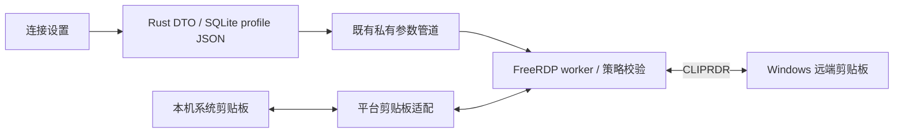

# RDP 双向剪贴板调研与实施方案

状态：配置、文本与文件的原生接入已实现，真实 Windows Server 双端传输仍待验收。

## 实施结果

- 新增逐连接 `clipboardMode` 三档设置，Rust 默认关闭、未知值拒绝；profile JSON 兼容旧数据，重启后保留选择。前端仍只传递设置。
- 引擎升级并固定到 FreeRDP 3.33.0，校验下载 SHA-256；构建目录包含版本号，避免复用旧版本 CMake 缓存。现有认证 / 证书 / 原生窗口适配锚点继续严格校验。
- macOS 使用上游 SDL3 与无 FUSE 的 Finder 文件桥。Windows 从同版上游 `wf_cliprdr.c` 生成独立适配，移除 Windows GUI 客户端上下文依赖，复用其 OLE 延迟文件读取和原生文本剪贴板。
- 双方格式列表和本机数据请求采用共同白名单：纯文本模式只允许 Unicode / 兼容文本；文件模式额外允许文件描述符与文件内容。HTML、图片和未知格式不开放。文本模式的文件能力位及 FileContents 回调也被禁用 / 显式拒绝，不只依赖参数。
- Windows 单次文件内容请求上限 4 MiB，数据等待改为 15 秒；断开时唤醒等待并关闭原生剪贴板窗口。文件传输仍由原生实现分块取数，不映射驱动器。
- 本机剪贴板发布限制为前台 worker。Windows 原生线程在前台切入时重新发布当前本机格式；macOS 在 SDL 焦点进入时刷新本机格式。后台远端格式不直接写入本机系统剪贴板。
- 新增原生白名单 / 拒绝文件请求测试；Rust 覆盖三档参数、关闭驱动器、旧数据默认、未知枚举拒绝与 SQLite 重启回读。认证、证书和 worker 生命周期另做回归。

验证边界：Windows 适配做 Windows 目标交叉编译检查，尚非 MSVC 全安装包验证；自动策略测试不等于真实 Explorer / Finder 与 Windows Server 的双向粘贴验收。多会话切换、文件中途改剪贴板、目录、超大文件和慢链路取消仍需实机验收。本文下方保留原始调研依据及验收清单，不能把所有建议都视为已经完成。

## 1. 目标与连接设置

在 RDP 连接编辑器增加“剪贴板共享”下拉菜单，每个连接独立保存：

| 选项 | 本机 → 远端 | 远端 → 本机 |
| --- | --- | --- |
| 关闭（默认） | 不传输 | 不传输 |
| 仅文本 | Unicode 纯文本 | Unicode 纯文本 |
| 文本和文件 | 纯文本、复制的文件 | 纯文本、复制的文件 |

保存后重新连接生效。旧连接保持关闭。选择文件模式时，界面应说明双方可通过复制 / 粘贴传输文件。
首版文件操作是“复制”，不实现跨机器剪切删除、拖放、磁盘映射或断点续传；图片及富文本格式不作为纯文本模式的隐式能力。
文件先覆盖普通单文件 / 多文件；目录复制和超大文件应单独验收，不提前承诺支持。

## 2. 已确认的现状

- `src-tauri/src/rdp/protocol.rs` 固定发送 `-clipboard` 和 `-drives`，目前不能通过设置启用。
- 已有独立 worker、私有参数管道与按工作台归属的会话，不需要增加另一条网络连接或安装服务器代理。
- 固定引擎是 FreeRDP 3.32.2 的 SDL3 客户端；`sdl_clip.cpp` 已实现文本格式协商、剪贴板更新、数据请求和响应，可作为文本能力基础。
- 同版 `client/common/client_cliprdr_file.c` 的 `cliprdr_file_context_has_local_support` 只在 `WITH_FUSE` 时返回真；本地实际 CMake 缓存为 `WITH_FUSE=OFF`。不能把含有 FileContents 回调等同于已具备系统文件管理器双向粘贴能力。
- SDL3 的文件列表桥接主要使用 `text/uri-list` 等 MIME，Windows Explorer 的文件复制还涉及 `CF_HDROP`、OLE 数据对象及延迟取数；已有 `client/Windows/wf_cliprdr.c` 是原生 Windows 客户端实现，依赖其上下文，不能直接链接进 SDL3 就当作完成。
- 3.32.2 的命令行能解析 `direction-to` / `files-to`，但该版 `sdl_clip.cpp` 没有消费 `ClipboardFeatureMask`。所以仅加参数不能证明“仅文本”或方向限制实际生效，必须检查并约束原生格式发布和数据处理路径。

这些是对当前固定版本的源码审查结论；不代表已进行真实服务器的剪贴板传输验收。

## 3. 接入现有架构

文本和文件内容由原生 worker 处理，不经 React、Tauri invoke、日志或配置数据库中转。继续保留独立原生桌面和现有 TLS / NLA、证书设置。

### 数据与参数

- Rust / TypeScript 同时新增 `clipboardMode: "off" | "text" | "textAndFiles"`。
- Rust enum 使用 `serde(default)`，默认 `off`；未知值拒绝，不能回退为全开放。
- 当前 SQLite 的 `rdp_profiles.profile_json` 已存完整 profile JSON，因此新增字段可通过兼容反序列化落地，无需增加 SQL 列或破坏旧库。
- `rdpService.saveRdpProfile` 显式解构 DTO，必须把新字段加入保存请求；新建默认值、编辑回填、复制配置等路径一起检查。
- `off` 不启用 CLIPRDR。其他模式启用通道并由 worker 在协商、格式列表、数据请求和响应四个入口落实模式。
- “仅文本”只允许 `CF_UNICODETEXT` 及必要的兼容文本转换，过滤 HTML、图片、文件描述符和文件流；不能只隐藏文件列表而仍响应文件内容请求。
- 文件模式使用 CLIPRDR 的 FileGroupDescriptorW / FileContents 流式请求，保留 `-drives`，不自动暴露本机磁盘。服务端策略禁止文件剪贴板时应提示受限，不尝试绕过。

### 平台实现

**Windows：** 以固定版本的 `wf_cliprdr.c` 为参考，把 OLE / IDataObject、格式协商与流读取的必要逻辑适配到独立的 SDL3 剪贴板上下文；处理 COM 线程归属、Explorer 的 `CF_HDROP`、远端虚拟文件的延迟读取以及取消。不能让 Windows 原生桥和 SDL 通用桥同时抢占同一通道的回调。

**macOS：** 优先评估上游 3.33.0 的 Finder 文件复制实现。上游发布说明明确新增无需 FUSE 的 macOS 文件剪贴板，相关入口包括 `WITH_CLIPRDR_FILE_APPLE` 和 `cliprdr_file_context_set_local_clipboard_data`。优先复用其文件承诺 / 系统剪贴板桥接；不要求用户安装 macFUSE。

3.33.0 于 2026-11-02 发布，包含大量其他引擎变化。建议先在隔离构建中评估升级并验证所有现有源码适配锚点；如果暂不升级，需连同必要依赖完整回移相关补丁，不能只复制一个源文件。本文不直接升级生产引擎，也不承诺升级后 Windows SDL3 文件复制自动可用。

### 生命周期与文件处理

- 多 RDP 会话共享本机系统剪贴板：只有前台会话发布新的本机剪贴板内容；已开始的文件读取固定到原会话和剪贴板代次，避免切窗后串线。
- 去重自身发布的剪贴板变更，避免本机与远端循环同步；本机有新复制内容时，不用旧的远端响应覆盖它。
- 文件按需、分块读取，不能把整个文件一次载入内存。限制并发、待处理请求、文件数量及临时缓存总量；具体限制在平台原型测试后确定。
- 接收端粘贴目标由 Explorer / Finder 或目标应用决定。校验远端文件名、相对路径和长度，拒绝绝对路径、`..` 和路径越界；不执行接收文件。
- 关闭、应用锁、网络断开时取消请求、释放回调 / COM 对象并清理未完成缓存；不无条件清空用户后来复制的本机剪贴板。已交付给系统粘贴操作的临时文件需按所有权和使用期回收。
- 剪贴板通道失败优先呈现为会话内的传输错误，不自动把仍可用的桌面会话标记为连接失败；真正的 worker 退出继续使用已有退出分类。

## 4. 实施顺序与验收

1. **能力原型：** Windows SDL3/OLE 双向普通文件、macOS Finder 双向普通文件；验证固定版本与 3.33.0 的差异以及现有 Windows 静态链接 / macOS 打包约束。
2. **连接配置与文本：** DTO、默认关闭、保存兼容、编辑器菜单、worker 策略，完成双向中文、emoji、多行、大文本和重复复制测试。
3. **文件模式：** 平台桥、按需取数、取消和缓存回收，完成单文件、多文件、中文 / 空格文件名、空文件、同名目标、权限不足及传输中断测试。
4. **完整验收：** Windows 客户端 → Windows Server、macOS 客户端 → 同一 Windows Server，覆盖开关关闭 / 文本 / 文件、保存重启、切换会话、锁定、断网和正常关闭。
5. **打包回归：** 原生窗口按钮、任务栏、认证和证书策略不回退；完整安装包脱离开发环境运行。保留 Windows/MSVC 和 macOS 编译及原生测试，不用跳过测试掩盖平台差异。

关键策略回归：旧 profile 默认关闭；关闭时不注册剪贴板通道；文本模式不能收发文件；文件模式不映射驱动器；未知枚举值拒绝；不把文本、文件内容或路径写入诊断日志。

## 5. 上游与协议参考

- [当前固定版 SDL3 剪贴板](https://github.com/FreeRDP/FreeRDP/blob/3.32.2/client/SDL/SDL3/sdl_clip.cpp)
- [当前固定版通用文件剪贴板](https://github.com/FreeRDP/FreeRDP/blob/3.32.2/client/common/client_cliprdr_file.c)
- [Windows 原生剪贴板参考](https://github.com/FreeRDP/FreeRDP/blob/3.32.2/client/Windows/wf_cliprdr.c)
- [3.33.0 发布说明](https://github.com/FreeRDP/FreeRDP/releases/tag/3.33.0)
- [3.33.0 SDL3 剪贴板](https://github.com/FreeRDP/FreeRDP/blob/3.33.0/client/SDL/SDL3/sdl_clip.cpp)
- [上游 macOS Finder 文件复制 PR #13591](https://github.com/FreeRDP/FreeRDP/pull/13591)
- [Microsoft：剪贴板重定向及服务端策略](https://learn.microsoft.com/en-us/azure/virtual-desktop/redirection-configure-clipboard)
